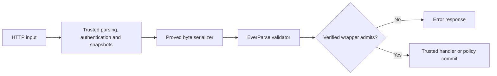

# Gateway mediation experiment

**Current R1 board evidence:** [Gateway/Validation/paper-evidence-r1-2026-09-29/REPORT.md](../Gateway/Validation/paper-evidence-r1-2026-09-29/REPORT.md).
The report below describes the earlier `1069e4b` experiment and its then-unflashed
image. R1 was subsequently built, flashed and tested on the NUCLEO-F767ZI. R1
also replaces the legacy access validator and extractor with the paper reference
versions; use the dated R1 report for current claims and limits.

This is an implementation and verification experiment on
`research/verified-mediation`, based on `1069e4b`. It changes the HTTP path in this
checkout but has **not been deployed**. `main` and the installed firmware remain
unchanged. Read [REPORT.md](REPORT.md) before interpreting the proof results.

The generated kernel builds the validator input, calls the appropriate EverParse
validator, and invokes the handler only on acceptance. Dashboard assets use fixed
public rules; login uses `LoginRequest`; protected APIs use `AccessRequest`;
policy replacement uses `PolicyBlob`. Invalid requests may produce errors without
invoking a handler. TLS remains deferred.



## Reproduce

The lock file identifies F*, KaRaMeL, Z3 and TLC by binary SHA-256 as well as source
revisions. The scripts default to the installations discovered on this host.
`FSTAR`, `KRML_HOME`, `Z3` and `TLA_JAR` can point to equivalent installations;
a different binary requires a reviewed lock update. The toolchain is not downloaded
or installed by these scripts. The existing generated runtime headers are reused.

```sh
# Prove the existing extractor contracts and the new wrapper; no code generation.
python3 Verification/tools/prove.py --replay

# Finite model plus six required counterexamples.
python3 Verification/tools/model.py

# Five proof-rejected mutations and one deliberately measured contract gap.
python3 Verification/tools/negative_proofs.py

# Only after successful proof checks: regenerate maintained wrapper C.
python3 Verification/tools/prove.py --extract
python3 Gateway/tools/check_project.py

# Real validators, independent byte oracle, and instrumented leaf handlers.
python3 Verification/tools/test_kernel.py

# Full portable application, including HTTP, login and live policy editing.
python3 Gateway/tools/test_host.py --sanitize
python3 Gateway/tools/test_host.py --sanitize --lab-auth-off

# Experimental builds and post-link checks. Does not flash/reset the MCU.
python3 Gateway/tools/build_firmware.py
```

Run extraction before builds/tests, not concurrently with them. F* proof outputs
and scratch caches are separated from maintained C. The integrity manifest ties
proof sources and generated C to the successful extraction run; it is an integrity
check, not a replacement for verification. The old generated extractor and
EverParse algorithms are never regenerated or modified by these commands.

## Interfaces and ownership

`gateway_http_process` consumes the complete HTTP request and authenticates API
requests. It calls `gateway_mediate`, which checks shape/state, copies the bounded
security parameters, serializes the active policy, and decodes login JSON without
credential/token effects. These handwritten preparation steps are trusted for
this first experiment.

`Mediation_Wrapper_run(kind, length, request, policy, login, context, scratch)`
receives 1536-, 65-, 106- and 106-byte buffers plus an aligned, complete `GatewayContext` object
(8,860 bytes on ARM, 8,864 bytes on this host). Input buffers
must be live and initialized, with the request-shape constraints in
`Mediation.Extern.input_valid`; context and scratch must be disjoint from each other
and all inputs. One gateway task owns them throughout the synchronous call.
`Mediation.Format` proves its byte mapping and bounds. The R4 experimental
`Mediation.Field.build_access` proves byte equality to that same mapping for
access kind 2 and is extracted separately for timing comparisons. The active
wrapper continues to use `Mediation.Format.build`. `Mediation.Extern.check`
bridges to the real validator. `Mediation.Extern.invoke` is the trusted leaf-effect
boundary. The public C API does not hand an authorization Boolean back to HTTP
code for later dispatch.

All three Low* files and the external contracts are under `lowstar/`; maintained
extracted C is under `Gateway/Generated/Mediation`. Do not edit generated bodies.
Fresh proof/extraction logs and negative experiment logs are under `evidence/`.
The model has a separate `tla/` directory and no assumed automatic refinement link
to Low* or C.

To collect completed runs into the report bundle:

```sh
python3 Verification/tools/collect_evidence.py \
  --host /path/to/host-artifacts \
  --auth-off /path/to/auth-off-artifacts \
  --build /path/to/build-artifacts
```

This collector reads existing results and copies logs; it does not run tests or
prove anything. Failed exploratory runs are explicitly labeled `initial-*`.
